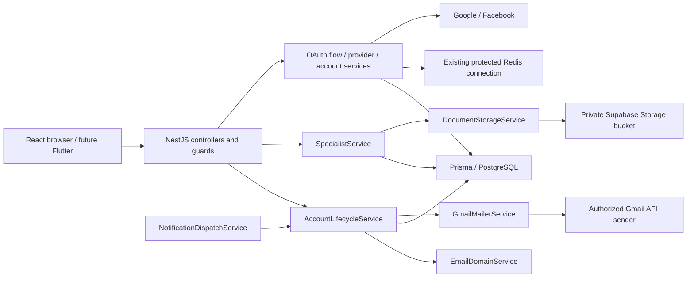

# Authentication and account management V2

## Scope, sources and release status

This implementation extends the existing NestJS modular monolith, Prisma-managed
User identity, Redis protection and React client. Flutter remains the approved
mobile client; no mobile implementation, alternate identity database, Supabase
Auth migration or FastAPI authentication endpoint was added.

The implementation audit read the repository's `AGENTS.md`, README files,
`docs/architecture.md`, authentication/admin documentation, source, Prisma schema,
migrations, configuration examples and tests. No separate PRD was found. The
owner's explicit Authentication & Account Management V2 request and subsequent
decisions supplement the available requirements. The lowercase architecture
filename is preserved. The approved branch base is Admin Portal V1 because its
PR was unmerged at the base decision; see the final delivery report for actual
Git commits, push status and dependent PR.

Implemented code covers separate Parent/Specialist registration, email domain
checks and verification, restricted onboarding sessions, provider authentication
and explicit linking, PDF-backed specialist applications, Admin decisions/audit,
localized screens, email templates and a small database-backed notification
dispatcher. Code and mocked-provider tests do not establish live-provider setup,
successful real mail delivery or a configured private storage bucket. These remain
release gates. There is no password recovery, refresh-token rotation, unlinking,
specialist resubmission after rejection, document replacement/deletion workflow or
child-data collection in this feature.

## Responsibilities and dependency map



Controllers apply DTO validation and HTTP contracts. `EmailDomainService` handles
registration syntax/domain checks, outside authorization guards. `AccountLifecycleService`
owns challenges and notification claims; `AccountSessionService` issues the
appropriate token. `JwtStrategy` enforces ordinary access using current database
state. `AccountAccessGuard` permits limited onboarding/account operations with
either a valid ordinary or onboarding token, while still checking the ACTIVE user.
`SpecialistService` owns professional state, documents and decisions. Provider
services separate secure provider proof, temporary Redis transport and local
account creation/linking. No provider secrets or database/storage access enter React.

## States and compatibility

Three independent concerns must remain distinct:

| Concern                  | Persisted state                                   | Meaning                                                   |
| ------------------------ | ------------------------------------------------- | --------------------------------------------------------- |
| Operational account      | `ACTIVE`, `PENDING`, `SUSPENDED`                  | Existing account control semantics                        |
| Email ownership          | `emailVerifiedAt`, `legacyAuthExempt`             | Verified evidence versus explicit legacy access exception |
| Professional application | `DRAFT`, `PENDING_REVIEW`, `APPROVED`, `REJECTED` | Independent specialist review lifecycle                   |
| Provider connection      | `AuthIdentity(provider, subject)`                 | Authentication identity, never public role assignment     |

New registrations have `status=ACTIVE`, `legacyAuthExempt=false`. ACTIVE alone
does not mean full access. New Parents require verified email. New Specialists
require verified email and an APPROVED application. Public registration accepts
only PARENT or SPECIALIST, with role fixed by the endpoint. ADMIN is never accepted
from public registration/provider input. Children remain profiles outside this work.

The migration explicitly exempts rows already present at migration time by setting
`legacy_auth_exempt=true`, then changes the default to false for future rows.
It does **not** fabricate `email_verified_at`, change existing roles/statuses or
rewrite existing email/password values. Existing eligible Parents, Specialists and
Admins retain their previous access through that explicit exception. Review the
actual target records and backup before applying this policy to another database.

Existing JWT signing algorithm HS256, 900-second lifetime, Redis login protection
and normal `/auth/me` response fields remain. New restricted JWTs have
`purpose=onboarding` and appear as `onboarding_token`, never `access_token`.
`JwtStrategy` rejects any purpose-bearing token. Restricted tokens permit only
explicit account/onboarding routes, not `/auth/me` or Admin APIs. Approval or email
verification does not upgrade an already issued onboarding token: authenticate
again to obtain ordinary access. Current suspension/demotion/approval is checked
from PostgreSQL on protected calls. Logout remains local token disposal without
server revocation; tokens expire naturally.

`POST /auth/register` remains the Parent endpoint alias with its original accepted
fields. Its behavior intentionally now requires verification, and its response
adds `verification.emailSent`. Login HTTP 200 is preserved, but callers must handle
the restricted response branch. Future Flutter clients must implement that branch
and the onboarding flow before using new registration. Legacy email normalization
and mixed-case collision handling from [authentication](authentication.md) remain.

## Email/domain validation and verification

DTOs use `class-validator` and the existing global ValidationPipe; unknown fields
are rejected. Names are trimmed, email is trimmed/lowercased, passwords are preserved
exactly. Registration requires a nonempty name up to 100 characters, a valid email
of at most 254 UTF-8 bytes, and password length 8–72 characters and at most 72 UTF-8
bytes. Dots/plus suffixes are preserved. Specialist fields are specialization 2–160
characters, qualification 2–200, and optional summary up to 2000. No national license
number or child information is required. Optional locale is `ar` or `en`.

`EmailDomainService` rejects malformed/IP/single-label/reserved/test/local domains
and known disposable entries before DNS. IDN domains use ASCII labels for DNS while
the existing identity normalization remains unchanged. MX records are checked;
explicit null MX is rejected. When MX data is absent, A/AAAA provides the RFC 5321
implicit-MX fallback. Authoritative nonexistent/no-route results return 400.
Temporary DNS failures return sanitized retryable 503; they are never cached as
permanent rejection. A 3000 ms whole-check deadline cancels outstanding DNS.
Positive/negative cache entries last five minutes, with at most 1000 domains and
32 concurrent distinct checks. Same-domain checks share pending work. Login never
rechecks DNS for an existing identity.

Disposable detection is an explicitly limited reviewed seed of 11 domains plus
reviewed injected additions, with subdomain matching. It is not comprehensive.
The source file pins a CC0 upstream snapshot and documents update/removal review:
[disposable-email-domains](https://github.com/disposable-email-domains/disposable-email-domains).
There is no popular-provider whitelist; unfamiliar legitimate university/business/
Palestinian domains can pass. DNS cannot prove inbox existence or ownership. IDN
identity equivalence and database-enforced case-insensitive email uniqueness remain
separate concerns; no legacy cleanup is performed automatically.

Password registration creates a 32-byte cryptographically random base64url token.
Only its SHA-256 digest, expiry and cooldown are stored. Validity is 60 minutes;
resend cooldown is 60 seconds. Verification links use `/verify-email#token=...` so
the token is not sent in the page request query. The browser submits it in the POST
body; application/proxy body logging must not capture it. There is no raw token in
database records or logs.

Verification conditionally consumes an unexpired, unconsumed matching challenge
inside a Prisma transaction, updates email verification, and atomically queues a
Parent welcome intent. A simultaneous replay has one winner. Specialist verification
does not approve the application or send an activation welcome. Resend normalizes
email, returns a generic message for absent/ambiguous/ineligible accounts and
atomically rotates an eligible challenge after cooldown. Prior links then fail.
Throttling and conditional database mutation both apply.

## API contracts

All JSON DTOs reject extra fields. Error bodies retain standard Nest formats
(`statusCode`, `message`, and `error` when supplied). Request rates are per IP,
per handler, in 60-second windows using existing Redis-backed throttling. Rejected
DTOs also consume requests. Proxy trust is not expanded. No new global error envelope.

| Endpoint                                          | Access / rate                             | Request                                                            | Success                                                  |
| ------------------------------------------------- | ----------------------------------------- | ------------------------------------------------------------------ | -------------------------------------------------------- |
| `POST /auth/register`                             | Public, 5/min                             | `fullName,email,password`                                          | 201 Parent registration response                         |
| `POST /auth/register/parent`                      | Public, 5/min                             | Parent fields, optional locale                                     | 201 registration response                                |
| `POST /auth/register/specialist`                  | Public, 5/min                             | Parent fields plus specialization, qualification, optional summary | 201 registration response                                |
| `POST /auth/login`                                | Public, 20/min plus account protection    | `email,password`                                                   | 200 ordinary or restricted session                       |
| `POST /auth/email/verify`                         | Public, 10/min                            | `token` (43 base64url characters)                                  | 200 `{message}`                                          |
| `POST /auth/email/resend-verification`            | Public, 3/min                             | `email`, optional locale                                           | 200 generic `{message}`                                  |
| `GET /auth/onboarding/me`                         | AccountAccessGuard                        | Bearer token                                                       | 200 `{userId,email,role,emailVerified,legacyAuthExempt}` |
| `GET /auth/me`                                    | Ordinary JWT                              | Bearer access token                                                | 200 `{userId,email,role}`                                |
| `GET /specialist/application/me`                  | Account token, current Specialist, 20/min | None                                                               | 200 application projection                               |
| `POST /specialist/application/document`           | Account token, current Specialist, 3/min  | Multipart `document`, one PDF, no extra parts                      | 200 `{message}`                                          |
| `GET /specialist/application/document`            | Owning Specialist account token, 20/min   | None                                                               | 200 PDF attachment                                       |
| `POST /specialist/application/submit`             | Verified Specialist, 20/min               | No body fields                                                     | 200 `{message}`                                          |
| `GET /admin/specialist-applications`              | Ordinary ACTIVE Admin, 20/min             | None                                                               | 200 `{applications:[...]}` (at most 100)                 |
| `GET /admin/specialist-applications/:id`          | Ordinary ACTIVE Admin, 20/min             | UUID path                                                          | 200 `{application:...}`                                  |
| `GET /admin/specialist-applications/:id/document` | Ordinary ACTIVE Admin, 20/min             | UUID path                                                          | 200 PDF attachment                                       |
| `POST /admin/specialist-applications/:id/approve` | Ordinary ACTIVE Admin, 20/min             | UUID path                                                          | 200 `{message}`                                          |
| `POST /admin/specialist-applications/:id/reject`  | Ordinary ACTIVE Admin, 20/min             | UUID path, `{reason}` trimmed 10–1000 characters                   | 200 `{message}`                                          |

Registration response is `{message,user:{id,fullName,email,role,status,createdAt},verification:{emailSent}}`.
`emailSent=true` means mail API acceptance, not confirmed inbox delivery. Registration
never returns a session token. A normal login returns
`{message,access_token,user:{id,fullName,email,role,status}}`; a restricted login uses
`onboarding_token` instead. Public responses omit password hashes, verification
digests, provider credentials, document keys and internal mail records.

Application detail contains `id,status,specialization,qualification,summary,submittedAt,fullName,email,hasDocument,reviews`.
Review projections contain decision, reason and timestamp. The list omits private
storage references and uses a bounded first page; pagination/search is not implemented.

OAuth endpoints are `POST /auth/oauth/start`, authenticated
`POST /auth/oauth/link/start`, `GET /auth/oauth/google/callback`,
`GET /auth/oauth/facebook/callback` and `POST /auth/oauth/finish`. Starts are 5/min;
callback/finish handlers are 20/min. Start accepts provider, login/register intent,
43-character browser challenge and a role only for registration. Link start accepts
provider/challenge; its account ID comes from authenticated server state. Finish
accepts completionId/verifier plus optional registration fields, never role/status/
approval. Starts return `{authorizationUrl}`; callbacks return protected popup HTML
with a completion identifier; finish returns the ordinary/restricted JSON session.
See [provider contracts, trust rules and setup](auth-account-v2-providers.md).

Errors: 400 invalid fields/domain/challenge/origin; 401 invalid credentials/token,
restricted token on a full-access route or inactive JWT identity; 403 role/ownership/
verification admission failure; 404 missing/inaccessible application document;
409 duplicate identity, unmet submission prerequisites or already-decided/conflicting
state; 413 HTTP upload-size limit; 429 IP/account throttling; 503 required Redis,
temporary DNS, missing/failed private storage or unavailable provider; unexpected
database/programming failures remain 500. A failed background notification does not
turn an already committed verification/review into a false account-operation failure.

## Specialist review and private documents

Applications start DRAFT. A required PDF can be attached once while DRAFT, then
submission conditionally moves a verified eligible applicant to PENDING_REVIEW.
Submitting twice, submitting without a document or uploading after attachment/
submission returns 409. This version has no application editing, document replacement
or rejection resubmission endpoint.

An ACTIVE Admin decides PENDING_REVIEW exactly once. The transaction locks the
current reviewer and eligible applicant user rows, conditionally changes status,
writes the reviewer/decision/reason audit and persists notification intents. A
concurrent approve/reject has one winner; the loser receives 409. Parent/self-review
and suspended/demoted Admin actions are denied. Approval does not alter role or
operational account status. Approval sends a decision notification and one welcome;
rejection sends a respectful decision notice without an activation welcome.

`DocumentStorageService` uses native fetch and `SUPABASE_URL`,
`SUPABASE_SERVICE_ROLE_KEY`, `SPECIALIST_DOCUMENT_BUCKET`. Missing/unsafe config
fails closed with 503. It checks bucket metadata for the exact private bucket on
every operation. It does not create/change buckets or expose public/signed URLs.
Keys are generated from the user UUID plus random UUID filename; uploaded names
and content-type declarations are not trusted. Maximum size is 5 MiB (5,242,880
bytes), enforced before HTTP buffering and again in the adapter. Header `%PDF-`
and trailing `%%EOF` checks are superficial PDF validation, not a complete parser,
sanitizer or malware scan. Private credential access must remain backend-only.

Metadata and download streams are bounded, requests reject redirects, and each
storage operation has a 10-second whole-operation deadline. Ownership comes from
the database/application service, not a caller-controlled storage path. Downloads
are attachments with PDF type, `nosniff`, no-store and a sandbox CSP. Operators must
protect the bucket's private setting and prevent public client policies. Metadata
checks do not make unauthorized external bucket-policy changes safe.

No automatic object deletion or retention period is approved. A storage upload
whose database association fails can leave a private orphan. No retry overwrites
or deletes it. Review access, retention, backups and orphan reconciliation before
production collection. A test mock demonstrates API coordination, not actual
Supabase privacy or storage compatibility.

## Mail templates and durable notification intents

The replaceable Gmail REST adapter uses owner-authorized OAuth, never a Gmail
password. Templates provide HTML and plain text in Arabic/English with RTL/LTR,
escaped user content and trusted-origin action links. Implemented kinds are
verification, verification resend, Parent/approved-Specialist welcome, application
received, specialist approved and specialist rejected. No unsupported account-change
notification or invented support address is exposed.

`MailDelivery` is a small database outbox with unique event keys. Parent welcome
intent is atomic with verification; specialist receipt/decision/welcome intent is
atomic with the related state transaction. Registration stores verification intent
alongside the challenge; provider account creation also stores the applicable intent.
Immediate dispatch is best effort. A persistence failure is logged with fixed
sanitized text and reports `false`, preserving the durable pending/uncertain state.

Before a network send, a conditional claim changes PENDING/FAILED to UNKNOWN.
API acceptance changes it to ACCEPTED. A crash, timeout or failed acknowledgement
can leave UNKNOWN; it is never blindly retried because the provider may already
have accepted the message. ACCEPTED means API acceptance only. An operator must
investigate UNKNOWN without assuming either delivery or safe resend.

Outside `NODE_ENV=test`, and only with the enabled/configured mail adapter,
`NotificationDispatchService` starts an unref'd 30-second timer without sending
at startup. Each tick selects at most 20 oldest PENDING/FAILED non-verification
notifications. There is one active batch per process; conditional database claims
coordinate multiple processes. Shutdown clears the timer and waits for the active
batch. Retry links are reconstructed from the fixed trusted application origin.
There is no separate queue infrastructure.

Verification/resend messages are excluded from automatic retry because their raw
tokens are deliberately not stored. If a process loses that token, an explicit
user resend rotates the challenge. Do not store raw tokens to make a worker retry
possible. Outbox status monitoring and manual handling of UNKNOWN remain required
operational work.

## Schema, migration and deployment gates

`20261109000100_auth_account_v2` adds nullable `password_hash` (provider-only users),
email verification/legacy exception/locale fields and AuthIdentity,
EmailVerification, SpecialistApplication, SpecialistReview and MailDelivery models.
It adds provider/subject and user/provider uniqueness, unique token digests, one
application/challenge per user and unique mail event keys, plus review/list indexes.
New dependent records cascade on User removal; reviewer deletion leaves its audit
reviewerId null. These relations are not authorization to delete accounts/data.

The migration was applied only to inspected dedicated localhost PostgreSQL after
the existing schema was present with zero users; its preservation test therefore
does not demonstrate a real legacy-data upgrade. No development/production Supabase
migration or target backup was performed. Final full-suite results belong in the
delivery report, not inferred from source or earlier focused runs.

Before any intended database application, the operator must:

1. Identify/confirm the target and obtain a verified recoverable backup; avoid
   printing connection strings or credentials. Review legacy users, case collisions,
   expected exemptions and provider-only account compatibility.
2. Rehearse migration on an isolated copy with synthetic representative existing
   rows, including Parent/Specialist/Admin and suspended users. Confirm existing
   rows become exempt without invented verification and new rows default false.
3. Review generated SQL and `prisma migrate status`; coordinate backend and client
   rollout because registration/login now have verification/onboarding semantics.
4. Apply only the approved migration using Prisma Migrate against the explicitly
   approved target. Never automatically apply test commands to Supabase.
5. Regenerate Prisma Client through the project command, build and verify login,
   registration, restricted access, review races and mail intent persistence.

Rollback needs a reviewed recovery/forward-fix plan. Returning old code against
nullable passwords/provider users can fail; dropping new tables/columns would lose
identities, challenges, reviews and delivery history. No destructive rollback SQL
is supplied. Do not reset, drop, rewrite users or fabricate email verification to
work around an unsuccessful deployment.

## Frontend routes and session behavior

React uses existing typed Arabic/English resources, layout and locale persistence.
New routes are `/register` (account type), `/register/parent`,
`/register/specialist`, `/verification-pending`, `/verify-email`,
`/application-status`, `/account/connections` and
`/admin/specialist-applications`. The status page represents draft, email-required,
pending, approved and rejected states; it uploads the required PDF and submits the
application. Admin review list/details/decisions are integrated with existing Admin
navigation. `/login`, `/home` and `/admin` remain.

Ordinary and onboarding JWTs remain in React memory, including OAuth completion.
No provider token enters browser storage. Route guards provide UX; backend guards
remain authoritative. Refresh loses the session. Existing language preference is
the only persisted browser preference. Public verification fragments are consumed
by the verification page; they are not authentication sessions. Popup messages are
accepted only from the configured backend origin and the exact popup source.
Completion verifiers remain in memory and protect the single-use backend exchange.

Forms expose labels, validation, loading/error feedback and keyboard focus; pages
support RTL/LTR and existing responsive styling. Automated component/axe/browser
coverage is evidence for tested cases only, not full WCAG conformance or real
provider success. See the final report for actually executed browser matrices.

## Configuration, verification and Windows commands

Use [provider/mail owner setup](auth-account-v2-providers.md) for Google Cloud,
Meta, Gmail consent, supported Graph version and exact callbacks. Configure the
requested sender only after actual ownership/authorization, keeping
`MAIL_ENABLED=false` until controlled delivery testing is expressly authorized.
Do not paste secrets into chat, PRs or commands. Vite configuration is public.

Additional backend runtime settings: `PUBLIC_WEB_ORIGIN` is one exact trusted origin;
private documents require `SUPABASE_URL`, `SUPABASE_SERVICE_ROLE_KEY`,
`SPECIALIST_DOCUMENT_BUCKET`. Retain DATABASE_URL/DIRECT_URL/REDIS_URL/JWT_SECRET/
PORT and exact WEB_CORS_ORIGINS. Backend credentials belong in ignored local or
deployment secret configuration. Restart after configuration changes. Real sending
and provider/storage smoke tests require separate controlled external setup.

Unit and substituted HTTP checks, from `backend`:

```powershell
npm.cmd test -- --runInBand
npm.cmd run test:http -- --runInBand
npm.cmd run lint
node node_modules/typescript/bin/tsc --noEmit --incremental false
npm.cmd run build
```

Real infrastructure checks require the full ownership/port/mount inspection and
explicit isolation attestation in [authentication test setup](authentication.md#safe-test-infrastructure).
Set TEST_DATABASE_URL/TEST_REDIS_URL securely to the dedicated localhost instances
and `NATIQ_TEST_ISOLATED=YES` only after inspection. The test Prisma config imports
no dotenv and rejects a development/Supabase endpoint. On a newly prepared approved
isolated database only, apply reviewed migrations with:

```powershell
node node_modules/prisma/build/index.js migrate deploy --config prisma.auth-test.config.ts
npm.cmd run test:redis -- --runInBand
npm.cmd run test:e2e -- --runInBand
```

`test/account-v2.e2e-spec.ts` uses real Nest, DTOs, PostgreSQL, Redis, JWT, bcrypt and
Throttler with test-only DNS/mail/storage adapters. It exercises parent onboarding,
token replay/concurrent consumption, resend rotation, real multipart upload,
specialist submission/review races/audit, current Admin status and attachment
ownership. DNS/mail/storage unit tests exercise those adapters with mocked transport;
neither level proves real external service setup. Each run scopes its rate-limit
keys and deletes only exact owned synthetic users/keys. No FLUSH/reset command.

From `web`:

```powershell
npm.cmd run typecheck
npm.cmd run lint
npm.cmd run format:check
npm.cmd test
npm.cmd run build
npm.cmd run test:browser
```

The opt-in `web/tests/real.browser.spec.ts` seeds one synthetic legacy-exempt Parent
on the validated isolated database and checks real login, identity, reload and local
sign-out. It does not register an account, bypass V2 verification or send mail.
Default controlled-response browser tests and real V2 HTTP workflows cover the
new registration lifecycle separately. Keep `NATIQ_WEB_REAL_API` unset unless the
isolated backend and container ownership have been explicitly inspected.
No real provider login, real mail or private storage call is authorized by a generic
test command. Avoid running multiple real infrastructure suites in parallel.

Troubleshooting: 503 DNS means retry later, not an invalid mailbox; registration
success with `emailSent=false` means account exists but no acceptance is confirmed.
Use the cooldown-controlled resend flow. Storage 503 requires private-bucket/config
inspection without exposing service keys. An onboarding token receiving `/auth/me`
401 is expected; complete verification/review and sign in again. A 409 review result
requires fetching current application state, not repeating decisions blindly.
Browser fetch/CORS errors do not prove that the server rejected or did not process
a registration. Review readable network status and existing CORS documentation.
