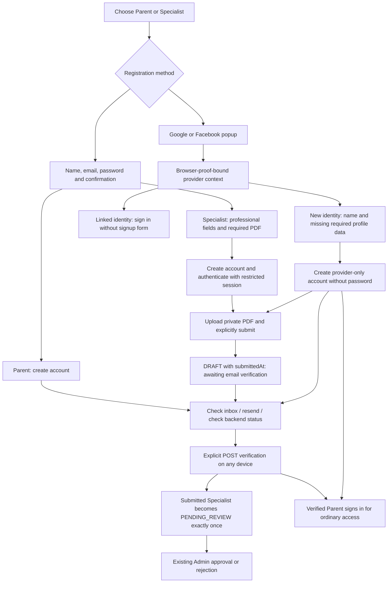

# Authentication and onboarding V3

This extends Authentication V2 and Admin Experience V2 from canonical commit
`857ba00ee852e2bfa962ff2370081c80eb998ac6`. The local integration branch and remote
`feature/oauth-provider-activation` matched that commit at the audit. Open PR #9
targets `feature/admin-experience-v2`; this feature depends on #9. No separate PRD
was found. The owner's V3 request supplies the requirements for this change.
`docs/architecture.md` retains its existing filename and architecture.

The owner explicitly approved the policy checkpoint on 2026-11-12: new verification
links last 24 hours; specialists may explicitly submit before verification using
existing DRAFT/submittedAt state; unverified applications are hidden from every
Admin read/count/document endpoint. There is no schema migration or backfill.
The owner separately approved optional mailbox verification for ACTIVE unverified
legacy accounts through resend. Missing challenges are created on explicit request;
concurrent first requests have one winner, and their login exemption stays intact.

## Confirmed original behavior and causes

V2 already implemented password registration, restricted onboarding JWTs, hashed
random email challenges, single-use transactional POST verification, 60-second
database resend cooldown, Redis IP throttling, private PDFs, audited specialist
decisions, Google/Facebook callbacks and explicit identity linking. Login uses
the current account and approval state. JWTs stay in memory. Password reset is
not implemented. No verification-code fallback was added.

The old UI mounted a traditional form and social completion together. It decided
whether provider registration needed more information from local input without
first obtaining validated provider context. Consequently provider users saw blank
email/name fields and the old password form. Registration had no confirmation
field; the specialist form was one long page. The pending screen could resend
but could not check status or display a cooldown. Links lasted 60 minutes.
Admin reads included unverified DRAFT applications despite verified submission
being enforced. Verification did not submit a previously saved draft.

## Current flow and state

The traditional specialist form has identity/professional stages; provider
completion replaces it while active. Confirmation is client-only, permits paste
and password-manager autocomplete, has separate visibility controls and never
enters an API payload. Errors focus the first invalid field and translate when
language changes. Back navigation preserves typed values. A required PDF is
selected before account creation, then uploaded through the existing authorized
endpoint after authentication. Server size/content/private-bucket checks remain.

Registration itself still returns no JWT. React uses the existing login endpoint
with the entered credentials to establish restricted access. If login, upload or
submission fails after creation, the UI reports that the account exists and offers
recovery through login/application status; it does not repeat signup. File uploads
and profile fields can be completed while unverified. Existing V2 does not support
editing professional fields after account creation, replacing an attached PDF or
resubmission after rejection; this change does not add those workflows.

## Backend contracts and concurrency

Existing registration/login/verification response shapes are preserved.

- New `POST /auth/oauth/context`: `{completionId, verifier}` only, with the same
  Redis challenge proof and 120-second completion expiry as finish. It does not
  consume or extend the completion. Returns `{provider, fullName, email,
emailTrusted, linked}` with nullable email and `Cache-Control: no-store`. No
  provider subject, tokens, local account ID or other account details are returned.
  DTO validation and the controller's existing Redis-backed 20/min limit apply.
  Wrong proofs and expired/consumed completions fail closed.
- `/auth/oauth/finish` remains single-use. Linked identities bypass signup even
  from a registration entry. New Google identities reuse provider name/email;
  Facebook requests contact email only if missing. Missing/untrusted mailbox
  ownership still requires local verification. Provider proof, Google token
  validation, subject binding and explicit account linking are unchanged.
- `/specialist/application/submit` now accepts a completed unverified application:
  with a persisted PDF, it atomically records `submittedAt`, keeping `DRAFT`.
  Response is `{message: "Application saved; email verification required"}`.
  Missing PDF/repeated submission still returns 409; wrong role/account fails.
  Verified submission keeps its existing message and `PENDING_REVIEW` behavior.
- Verification and submission lock the applicant user row in PostgreSQL before
  changing state. `promoteSubmittedApplication` requires actual verified email,
  ACTIVE SPECIALIST, DRAFT, non-null submittedAt and documentKey. The conditional
  transition and unique application notification intent are one transaction.
  Untouched drafts stay DRAFT. Verification never approves an application.
- `/auth/onboarding/me` remains the authenticated status authority across devices.
  Checking never verifies email, creates accounts or upgrades restricted JWTs.
  Refresh/new tabs lose memory-only sessions and require normal authentication.
  Restricted Parents return to `/verification-pending`, including after password
  login or an old `/application-status` link; Specialists retain profile access at
  `/application-status`. Resend uses the authenticated account's read-only email
  when a session exists, so checking status cannot be confused with another address.
- All Admin application lists, summary/dashboard counts, detail and PDF reads
  require non-null `emailVerifiedAt`. Decisions recheck this at the locked applicant
  row. Legacy authentication exemptions are unchanged for login but are not treated
  as mailbox verification for Admin review. Counts include only verified owners;
  total still includes their drafts, matching the existing dashboard distinction.

Deploy this frontend/backend together for the additive context endpoint and changed
submission semantics. Old clients can continue to submit after verification.
No Flutter or FastAPI implementation was changed. No dependency was added.

## Verification, resend and delivery

New password/provider-local-verification challenges use the existing random
32-byte token, SHA-256 verifier, conditional unexpired/unconsumed update, fragment
URL and explicit POST landing action. Old links retain their original expiry;
they are not extended or backfilled. Refreshing the landing page after its
fragment has been erased requires reopening the email or requesting a new link.
Scanners opening the page do not consume a token. Replay/expiry/invalid links are
rejected. Confirmation on another device does not issue a session there.

Arabic RTL and English HTML/text mail reuse the approved Gmail transports, branding,
safe CTA/fallback URL and ignore-request notice. Verification copy now states
24 hours. Registration `emailSent` means transport acceptance, not inbox delivery.
The sender configuration is untouched. No real test mail was sent.

Resend retains neutral content, 60-second conditional database cooldown, challenge
replacement and Redis IP throttling. React displays an absolute-deadline countdown
and offers actual verification to legacy owners without labeling their login
exemption as verified email. A missing challenge is created on request using Prisma
upsert; uniqueness races return the same neutral response, without extra sending.
The countdown honors a longer Retry-After. A global disabled/misconfigured mail service returns
503 identically for every supplied address. Eligible resend records an intent and
dispatches outside response latency, avoiding the old provider-send timing signal.
It never claims inbox delivery. This is not a constant-time guarantee: database
lookup/write timing still differs. An individual transport failure stays private
in delivery state; the public response cannot reveal recipient-specific delivery.

As in V2, raw verification tokens are not stored in the outbox. A process crash
before dispatch can leave an unsent challenge/intent; the user must explicitly
resend after cooldown. Unknown transport acceptance is never blindly retried.
No retention cleanup, token persistence or new durable secret queue was introduced.

## Verification and release gates

See the [Arabic delivery report](auth-onboarding-v3-delivery.ar.md) for actual
commands/results and [screenshots](assets/auth-v3/README.md) for synthetic browser
fixtures. PostgreSQL/Redis tests use the inspected dedicated loopback containers,
scoped synthetic rows/keys and a mail sink/private-document substitute. Provider
tests do not establish real OAuth, live private storage or inbox delivery.

Before release the owner must smoke-test configured Google and Meta test identities,
authorized inbox delivery and private storage. Keep the existing provider dashboard
activation requirements. No credentials, environment files, production users,
Supabase schema or `opencode.json` were changed by this task.

References consulted: [Google backend identity and mailbox authority](https://developers.google.com/identity/sign-in/web/backend-auth),
[Google OIDC](https://developers.google.com/identity/openid-connect/openid-connect),
[OWASP Authentication and federated account linking](https://cheatsheetseries.owasp.org/cheatsheets/Authentication_Cheat_Sheet.html),
[OWASP Session Management](https://cheatsheetseries.owasp.org/cheatsheets/Session_Management_Cheat_Sheet.html),
[WCAG 2.2](https://www.w3.org/TR/WCAG22/).
